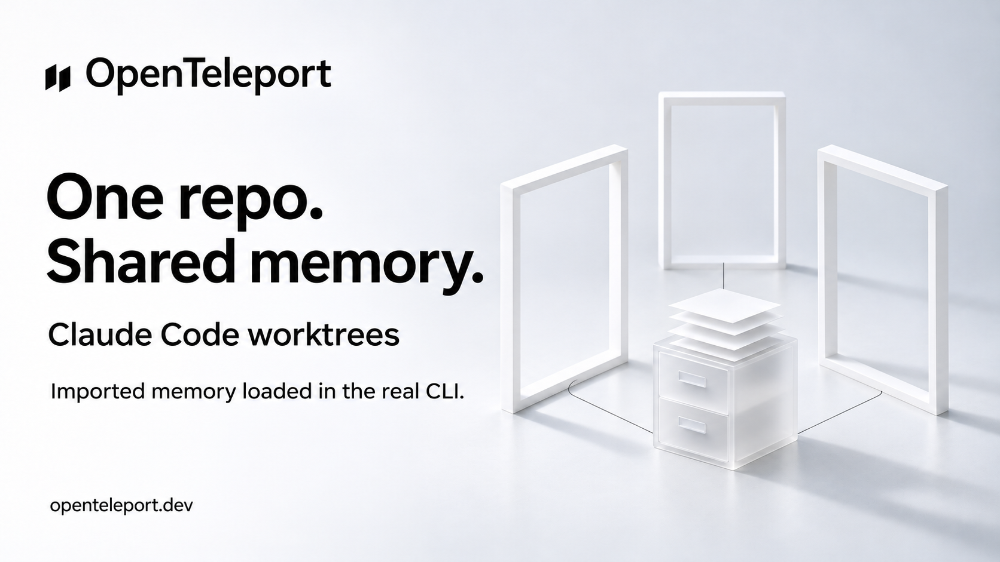

# X draft — Claude Code worktree memory

Status: Prepared, not posted. The code fix is for the next patch release, 0.4.5; the upcoming-version wording is intentional until npm publication is verified.

## Post

Switching worktrees shouldn't lose your agent's memory.

OpenTeleport now imports Claude Code memory into the shared repository location. Verified in the real CLI across five folder layouts.

Open source. Coming in 0.4.5.

https://openteleport.dev

## Image

## Evidence and scope

[Native report](../superpowers/research/2026-11-03-claude-worktree-memory.md). Imported memory was present in outgoing Claude Code 2.1.273 prompts in five temporary layouts. A local HTTP endpoint stopped every request before model execution; no live-model response is claimed.

## Image generation

Built-in ImageGen, using the existing folder-discovery artwork as a style reference. Saved as a new sibling; original artwork unchanged.

Prompt:

> Use case: ads-marketing. Produce a NEW OpenTeleport branded campaign sibling using the attached reference for identity and visual style. Preserve the exact black two-slanted-parallelogram mark with OpenTeleport wordmark at top left. Landscape 16:9, refined white/cool-grey studio, bold Swiss sans black type, ample negative space. Main headline left, exactly: 'One repo.' then 'Shared memory.' Medium subline: 'Claude Code worktrees'. Small qualification: 'Imported memory loaded in the real CLI.' Footer: 'openteleport.dev'. Right half: three elegant thin white rectangular portal frames branching in a subtle fan around ONE central translucent white file cabinet or sculptural stack of papers, connected by fine graphite lines on the studio floor, conveying multiple workspaces sharing one memory. Photorealistic restrained paper sculpture, soft daylight shadows, crisp editorial design. No colorful glow, no third-party logos, no screenshots, no extra text, no version badge, no claim that a live model turn was tested.
