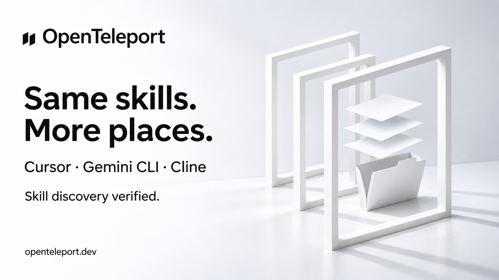

# X draft — folder skill discovery

Status: ready, not posted. [0.4.4 is published](https://www.npmjs.com/package/openteleport/v/0.4.4) and verified as npm latest; the production website serves 0.4.4. Publication and fresh-install checks are recorded in [STATUS](../STATUS.md#release).

## Post

Your skills shouldn't disappear when you switch tools.

We checked skill discovery in Cursor, Gemini CLI and Cline's skills CLI—and fixed the folder layout.

New in OpenTeleport 0.4.4. Plain files. Open source.

https://openteleport.dev

## Image

Alt text: OpenTeleport. Same skills. More places. Cursor, Gemini CLI, Cline. Skill discovery verified. A white folder and floating pages stand inside three white portal frames.

## Evidence and scope

[PR #40](https://github.com/Open-Teleport/openteleport/pull/40) and the Folder row in [demo.md](../demo.md). Claude verified Cursor 3.27.22 showing the skill and AGENTS.md, Gemini CLI 0.66.0 listing the skill, and the skills CLI invoked by Cline 3.0.74 listing it. These checks did not include model turns or confirmation that Gemini loaded the AGENTS.md import after sign-in. The update also protects foreign and edited skill mirrors and refuses linked tool-skill roots; isolated tests cover these cases. Local validation: 2755 tests passed, 12 skipped, type check, build and installed-package verification passed.

## Image generation

Generated with built-in ImageGen. Style reference: `assets/2026-11-03-codex-check-v2.png`. Saved as a new sibling; existing artwork is unchanged.

Prompt:

> Use case: ads-marketing. Create a NEW sibling campaign image for OpenTeleport, using the attached image only as brand/style reference. Keep the same precise black two-slanted-parallelogram mark and OpenTeleport wordmark at upper left, clean white/cool grey studio palette, generous whitespace, bold Swiss sans serif typography, elegant realistic sculptural paper-and-portal treatment. Landscape 16:9. Replace ALL campaign text with exactly: big headline left 'Same skills.' on first line, 'More places.' on second line. Below headline medium text 'Cursor · Gemini CLI · Cline'. Below that smaller but readable 'Skill discovery verified.' Footer bottom left 'openteleport.dev'. On the right create an open white paper folder with three white sheets suspended above it, framed by three slim white rectangular portals in perspective, subtle cast shadows on white studio floor. Physical sculptural still life, restrained polished monochrome, no colorful glow, no screenshots, no extra text, no third-party logos, no claims that model turns were tested, no version badge. The image should feel like a cohesive sibling to the reference, not a copy of its old message.
