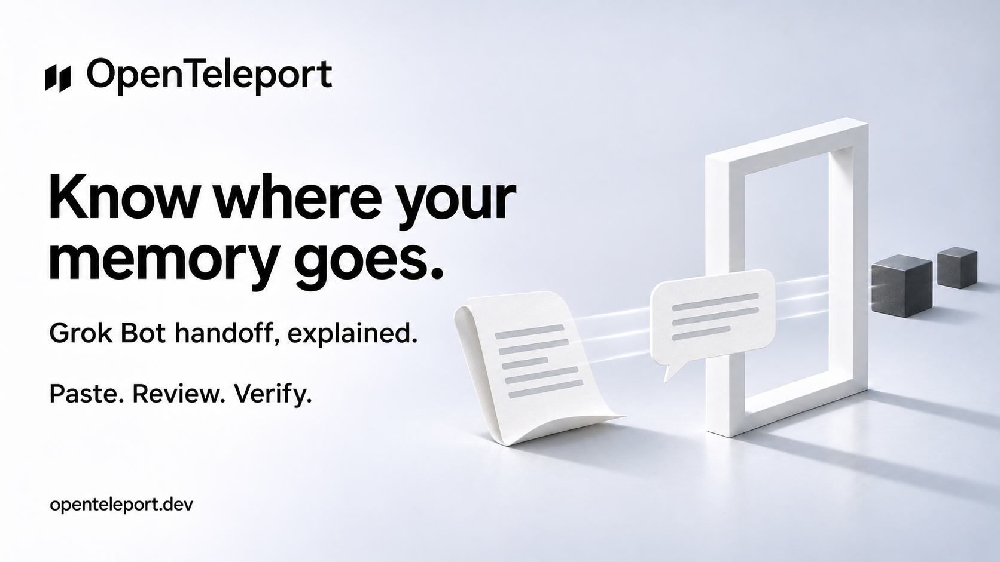

# X draft — Grok memory guidance

Status: Ready, not posted. Public npm 0.4.6 verified.

## Post

Where does imported memory actually go?

In Grok Bot, Add to Memory asks a Bot to save pasted facts as shared memory. OpenTeleport 0.4.6 now makes that clear.

Checked against the installed app's code. Live verification is still open in #17.

https://openteleport.dev

## Image

## Scope

Installed Grok Bot 0.78.1 code inspection only. No live import, export or recall claim. See [the report](../superpowers/research/2026-11-03-grok-memory-import.md).

## Image generation

Built-in ImageGen. Reference: the Letta campaign artwork, used for brand and visual style. Prompt: new sibling 16:9 OpenTeleport campaign image with the paired diagonal black mark and wordmark, white/cool grey studio, black Swiss typography, soft daylight and paper sculpture. Headline: "Know where your memory goes." Subline: "Grok Bot handoff, explained." Scope: "Paste. Review. Verify." Footer: "openteleport.dev". Document feeding a paper speech card, two charcoal cubes beyond a white portal. No third-party logos, UI or claim of verified import or automatic persistence. Saved as a new asset; original retained.
