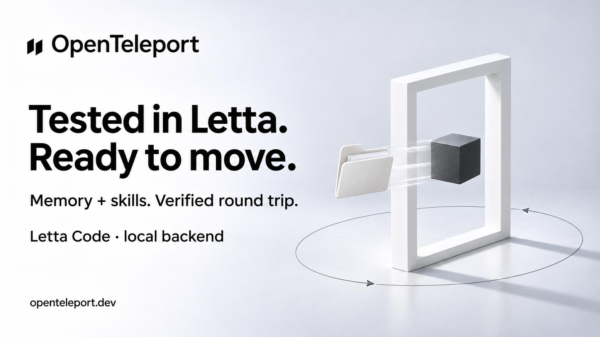

# X draft — letta-verified

Status: Ready, not posted. Public npm 0.4.6 verified.

## Post

Your agent's memory should survive the move.

Tested OpenTeleport with real Letta Code: memory and skills went in, then came back intact. The handoff now creates the Git snapshot Letta needs.

Local backend verified. Open source.

https://openteleport.dev

## Image

## Scope

Letta Code 0.34.39 local backend, generated Bash handoff, native memory export and facts/skills re-export. No model or cron execution. See [evidence](../superpowers/research/2026-11-03-letta-runtime-check.md).

## Image generation

Built-in ImageGen; existing nightly artwork used as a brand/style reference. New sibling saved without modifying the original. Prompt: white/cool-grey 16:9 studio, exact OpenTeleport logo and wordmark, bold black Swiss typography, white portal, charcoal cube, paper sculpture, soft daylight. Headline: "Tested in Letta. Ready to move." Subline: "Memory + skills. Verified round trip." Scope: "Letta Code · local backend". Circular return path on the floor. Footer: "openteleport.dev". No third-party logos, UI, neon or model-execution claim.
