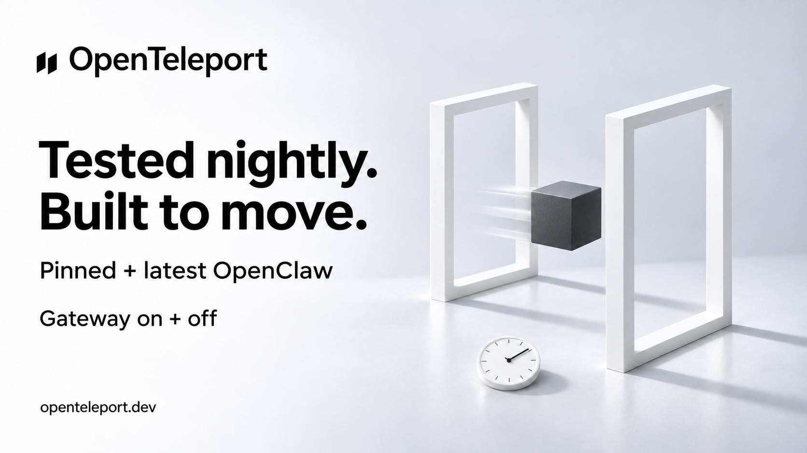

# X draft — Nightly compatibility

Status: Ready, not posted. PR #43 is merged; the workflow is active. No npm release was required.

## Post

AI apps update. Your agent setup still needs to move.

OpenTeleport now checks real OpenClaw transfers every night: pinned + latest, Gateway on + off.

Four checks. All passed. Open source.

https://openteleport.dev

## Image

## Evidence and scope

The [first CI run](https://github.com/Open-Teleport/openteleport/actions/runs/41562041947) passed all four six-test jobs: OpenClaw 2026.10.8 and latest resolved to 2026.10.9, Gateway off/on. Synthetic Claude Code files pass through a real OpenClaw install. No model execution or provider credentials.

## Image generation

Built-in ImageGen, using the existing folder-discovery artwork as a style reference. Saved as a new sibling; original artwork unchanged.

Prompt:

> Use case: ads-marketing. Create a new OpenTeleport campaign sibling using the attached image as brand/style reference. Preserve the exact black two-slanted-parallelogram mark and OpenTeleport wordmark at upper left. Landscape 16:9, clean white and cool-grey studio, bold Swiss sans serif black typography, generous whitespace. Replace campaign headline with exactly 'Tested nightly.' on first line and 'Built to move.' on second line. Below in readable medium type: 'Pinned + latest OpenClaw'. Next line: 'Gateway on + off'. Footer: 'openteleport.dev'. On the right a photorealistic minimalist sculptural arrangement of two slim white rectangular portal frames, a charcoal cube moving between them, and a tiny white analogue clock dial on the floor. Soft realistic shadows, paper-white materials. No neon, no third-party logos, no invented interface, no other words, no claim of model testing. This is a new branded post asset, keep the polished visual identity but change the scene and all campaign copy as specified.
