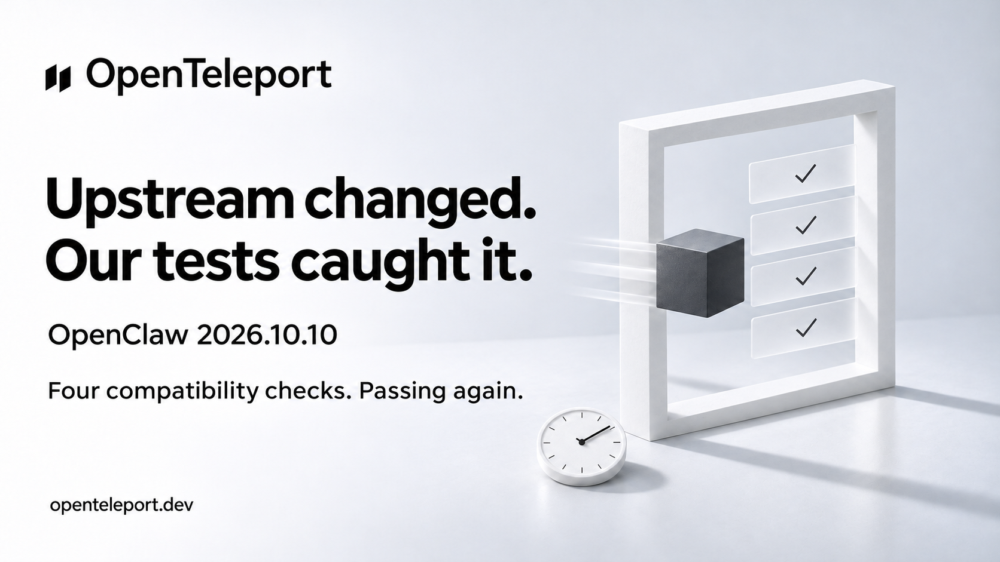

# X draft — openclaw-preflight

Status: Ready, not posted. PR #46 merged; four compatibility checks passed.

## Post

Our nightly tests caught an OpenClaw update before we called it compatible.

2026.10.10 now checks model auth even for disabled routines. We fixed the isolated test setup. All four checks pass again.

That's why we test real apps.

https://openteleport.dev

## Image

## Scope

[Compatibility run](https://github.com/Open-Teleport/openteleport/actions/runs/41645003736): pinned 2026.10.8 and latest 2026.10.10, Gateway on/off. This changes test setup, not the npm adapter. Synthetic provider credentials, local rejection endpoint, zero model requests.

## Image generation

Built-in ImageGen; existing nightly artwork used as a brand/style reference. New sibling saved without modifying the original. Prompt: white/cool-grey 16:9 studio, exact OpenTeleport logo and wordmark, bold black Swiss typography, white portal, charcoal cube, paper sculpture, soft daylight. Headline: "Upstream changed. Our tests caught it." Subline: "OpenClaw 2026.10.10" and "Four compatibility checks. Passing again." Four graphite checks on translucent panels and a clock. Footer: "openteleport.dev". No third-party logos, UI, neon or model-execution claim.
