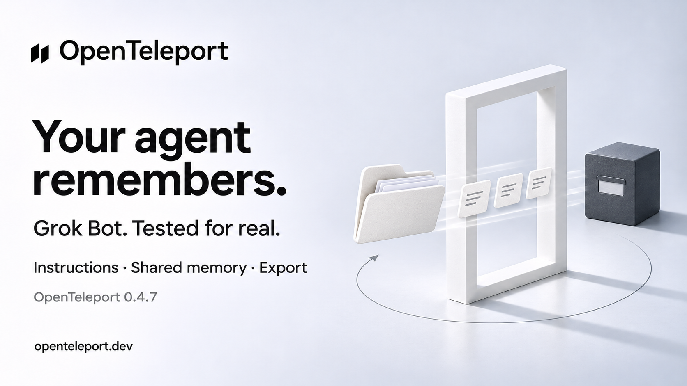

# X draft — Grok Bot live verification

Status: Ready after evidence merge; not posted.

## Post

A fresh Grok Bot remembered facts imported with OpenTeleport.

Then we exported the test agent back: its instructions and all 3 facts survived the folder round trip.

Tested on Grok Bot 0.78.4 with OpenTeleport 0.4.7.
Open source.
https://openteleport.dev

## Image

## Scope

Synthetic instruction/fact handoff, fresh-Bot shared-memory recall, genuine Bot-produced OpenBot-format export and a folder round trip. General import routed to the main Bot and changed shared memory. Title was unavailable; avatar/files/skills/routines/channels were excluded. No automatic Bot import or universal lossless-migration claim. [Evidence](../superpowers/research/2026-11-04-grok-live-check.md).

## Image generation

Built-in ImageGen with the SSH campaign as a style reference. Retain the Shift mark, white studio, charcoal type and physical portal. Headline: "Your agent remembers." Subhead: "Grok Bot. Tested for real." Scope: "Instructions · Shared memory · Export". Version: "OpenTeleport 0.4.7". Footer: "openteleport.dev". White folder and three memory cards passing through a portal toward a charcoal archive cube. No third-party logos, fictional UI or universal-migration promise.
