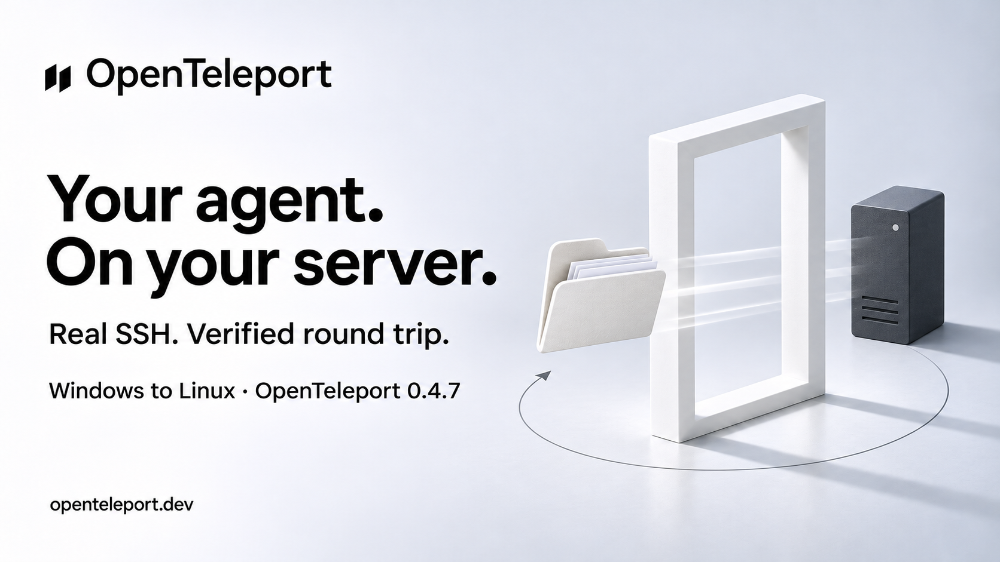

# X draft — real SSH verification

Status: Ready, not posted. Public npm 0.4.7 verified.

## Post

Your agent should survive a change of machine.

We tested OpenTeleport 0.4.7 over real SSH: Windows to Linux and back. The agent folder kept its memory and skill. Even the first remote npm download was part of the test.

Open source.
https://openteleport.dev

## Image



## Scope

Folder adapter, Windows OpenSSH to a disposable Linux server, synthetic data, public npm package. No claim about remote model behavior or every adapter. [Evidence](../superpowers/research/2026-11-04-real-ssh-check.md).

## Image generation

Built-in ImageGen. Reference: Letta campaign artwork for brand/style. Prompt: new 16:9 campaign image, paired black diagonal logo and OpenTeleport wordmark, cool white studio, black Swiss typography, paper sculpture, soft shadows. Headline: "Your agent. On your server." Subline: "Real SSH. Verified round trip." Scope: "Windows to Linux · OpenTeleport 0.4.7". Footer: "openteleport.dev". White folder and paper passing through a white portal toward a charcoal server tower; subtle return arrow. No third-party logos, UI, neon or universal-compatibility claim.
